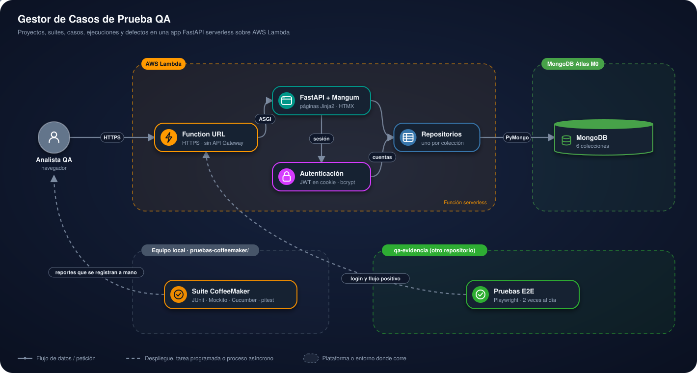

# Gestor de casos de prueba QA

<p>
  <a href="https://immxew65sfxj7nubwzlszdimfi0qegzc.lambda-url.us-east-1.on.aws/"></a>
  <a href="https://frontend-nine-topaz-99.vercel.app"></a>
  <a href="https://d4i3vsgw7xwmh.cloudfront.net"></a>
</p>


> 📘 **[Manual de usuario](docs/MANUAL.md)**: cómo usar cada pantalla, paso a paso y con imágenes.

## Contenido

1. [Presentación](#1-presentación)
2. [Funcionalidades](#2-funcionalidades)
3. [Arquitectura](#3-arquitectura)
4. [Estructura del proyecto](#4-estructura-del-proyecto)
5. [Instalación para pruebas](#5-instalación-para-pruebas)
6. [Autor y licencia](#6-autor-y-licencia)

---

## 1. Presentación

Aplicación web para equipos de QA: organiza proyectos, suites y casos de prueba, registra
ejecuciones con su resultado, vincula defectos y mide la cobertura.

- **Qué hace:** es el cuaderno de trabajo de un equipo de QA. Ahí se define qué se va a probar, se
  anota el resultado de cada ejecución y se reportan los defectos encontrados.
- **Qué muestra:** cuánto está cubierto y cómo van los resultados, por proyecto y por suite.
- **Cómo probarlo:** entra a la [demo](https://immxew65sfxj7nubwzlszdimfi0qegzc.lambda-url.us-east-1.on.aws/),
  crea una cuenta y arma tu primer proyecto.

Es la capa visible del proyecto de QA y automatización del portafolio. La suite de pruebas real vive
en [`pruebas-coffeemaker/`](pruebas-coffeemaker/README.md): JUnit, Mockito, JaCoCo, Cucumber y
mutation testing (pitest) sobre el dominio CoffeeMaker. Esas pruebas corren aparte y sus resultados
se registran aquí como ejecuciones, con sus reportes como evidencia.

## 2. Funcionalidades

- Registro e ingreso con verificación en dos pasos obligatoria (app autenticadora o código por correo).
- Recuperación de la contraseña y del autenticador por correo.
- Proyectos, suites y casos de prueba, organizados jerárquicamente.
- Ejecuciones con resultado: aprobado, fallido, bloqueado u omitido.
- Defectos vinculados a una ejecución fallida, con severidad y estado.
- Dashboard de cobertura y resultados por proyecto y por suite.
- Adaptable a celular, tablet y computador, tema claro y oscuro, e instalable como aplicación.

## 3. Arquitectura

<p align="center">
  
</p>

| Capa | Tecnología |
|---|---|
| Servidor | FastAPI |
| Interfaz | Jinja2 + HTMX |
| Datos | MongoDB |
| Pruebas | pytest en el despliegue; pruebas E2E diarias con Playwright |
| Despliegue | Se publica solo desde GitHub en cada cambio a `main`, después de pasar las pruebas |

## 4. Estructura del proyecto

```
backend/
├── app/
│   ├── main.py           Punto de entrada
│   ├── routers/          Páginas por sección
│   ├── repositorios/     Acceso a datos
│   ├── templates/        Plantillas Jinja2
│   └── static/           Estilos, íconos y tema claro/oscuro
├── tests/                Pruebas (pytest)
└── requirements.txt
pruebas-coffeemaker/      Suite de automatización QA (README propio)
docs/                     Manual de usuario y diagramas
```

## 5. Instalación para pruebas

Requisitos: Python 3.12 y una base MongoDB propia.

```bash
cd backend
python -m venv .venv
.venv\Scripts\Activate.ps1        # Windows (en Linux o macOS: source .venv/bin/activate)
pip install -r requirements.txt
```

Copia `.env.example` como `.env` en la raíz y completa las variables que indica la plantilla. Nunca
subas tu `.env` al repositorio.

```bash
cd backend
uvicorn app.main:app --reload      # http://127.0.0.1:8000
python -m pytest tests             # pruebas (no necesitan la base)
```

## 6. Autor y licencia

**Luis F. A.** · [GitHub](https://github.com/lariasca1994) · [LinkedIn](https://linkedin.com/in/lfac1)

Contacto: Telegram [@lfac6](https://t.me/lfac6) · WhatsApp [@carraian160](https://wa.me/carraian160) ·
[ariascluisf@hotmail.com](mailto:ariascluisf@hotmail.com)

Licencia: MIT.
