# 📘 Manual de usuario · Gestor de casos de prueba QA

## 1. Portada

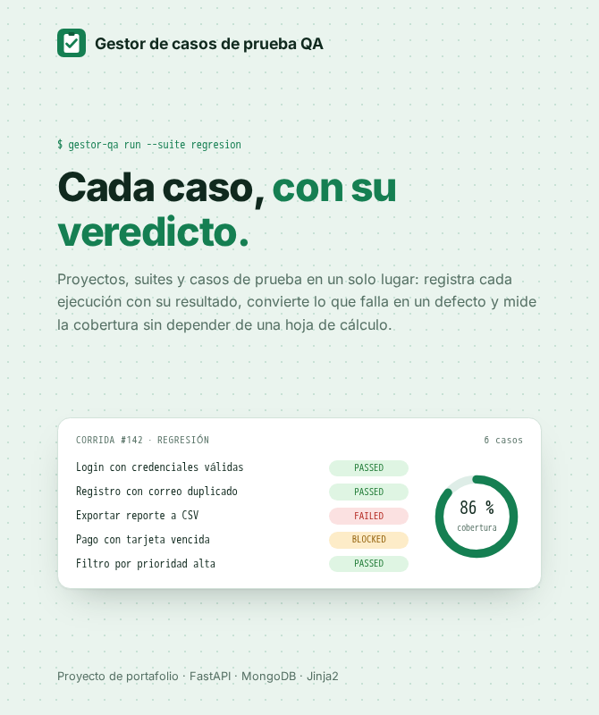

| | |
|---|---|
| **Producto** | Gestor de casos de prueba QA |
| **Documento** | Manual de usuario |
| **Versión** | 2.0 · noviembre de 2026 |
| **Dirigido a** | Analistas de pruebas, líderes de QA y desarrolladores |
| **Dirección** | [Gestor de casos de prueba QA](https://immxew65sfxj7nubwzlszdimfi0qegzc.lambda-url.us-east-1.on.aws/) |
| **Autor** | Luis F. A. |

## Contenido

1. [Portada](#1-portada)
2. [Introducción](#2-introducción)
3. [Objetivo](#3-objetivo)
4. [Alcance](#4-alcance)
5. [Acceso al sistema](#5-acceso-al-sistema)
6. [Pantalla principal](#6-pantalla-principal)
7. [Navegación](#7-navegación)
8. [Funcionalidades](#8-funcionalidades)
9. [Gestión de perfil](#9-gestión-de-perfil)
10. [Mensajes frecuentes](#10-mensajes-frecuentes)
11. [Preguntas frecuentes](#11-preguntas-frecuentes)
12. [Glosario](#12-glosario)

---

## 2. Introducción

El **Gestor de casos de prueba QA** reúne en un solo lugar los proyectos, las suites y los casos de
prueba de un equipo. Cada vez que se ejecuta un caso se registra su resultado; lo que falla se
convierte en un defecto con su origen, y un dashboard muestra la cobertura sin depender de una
hoja de cálculo.

Este manual explica cada pantalla, paso a paso y con imágenes.

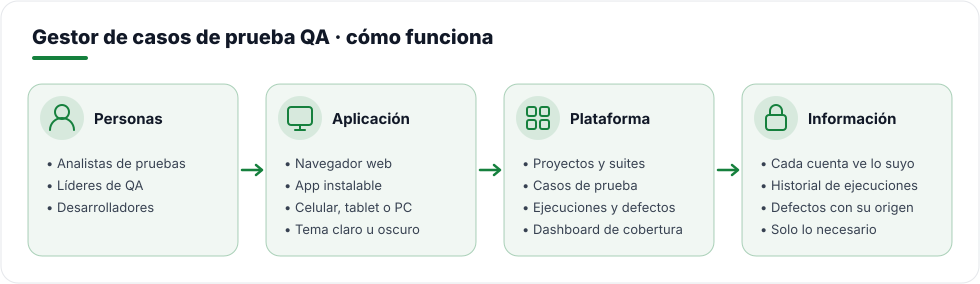

## 3. Objetivo

Que cualquier persona del equipo pueda, sin conocimientos técnicos:

- Crear su cuenta e ingresar de forma segura.
- Organizar las pruebas en proyectos, suites y casos.
- Registrar cada ejecución con su resultado y reportar los defectos encontrados.
- Consultar la cobertura y los resultados de cada proyecto.

## 4. Alcance

**Incluye:** registro e ingreso con verificación en dos pasos, proyectos, suites, casos de prueba,
registro de ejecuciones, defectos con su severidad y dashboard de cobertura.

**No incluye:** ejecución automática de pruebas ni integración con otras herramientas de gestión.

**Qué necesitas:** un navegador actualizado, conexión a internet, un correo propio y una app
autenticadora en el celular (o acceso a tu correo para recibir códigos).

**Buenas prácticas:** es una plataforma de demostración; no registres datos personales ni
información confidencial de tus proyectos reales en los casos o comentarios.

## 5. Acceso al sistema

### 5.1 Crear una cuenta

En la pantalla de ingreso pulsa **Regístrate**.

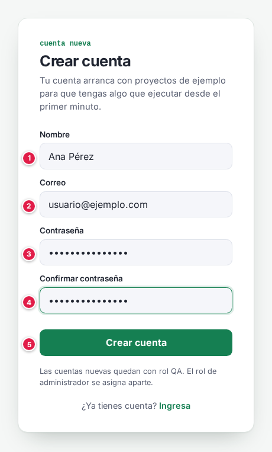

| # | Campo | Qué escribir |
|:-:|---|---|
| 1 | Nombre | Tu nombre, como lo verá el equipo |
| 2 | Correo | Un correo al que tengas acceso |
| 3 | Contraseña | Mínimo 8 caracteres |
| 4 | Confirmar contraseña | La misma contraseña |
| 5 | Crear cuenta | Crea tu cuenta y te lleva a configurar la verificación en dos pasos |

### 5.2 Iniciar sesión

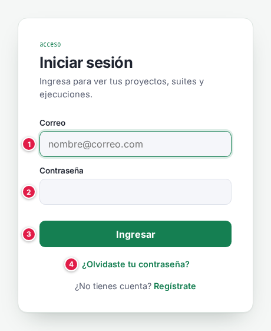

| # | Elemento | Qué hace |
|:-:|---|---|
| 1 | Correo | El correo de tu cuenta |
| 2 | Contraseña | Tu contraseña |
| 3 | Ingresar | Comprueba tus datos y pasa a la verificación en dos pasos |
| 4 | ¿Olvidaste tu contraseña? | Abre la recuperación de contraseña (5.4) |

Debajo, **Regístrate** abre el registro (5.1).

### 5.3 Verificación en dos pasos

Cada ingreso pide, además de la contraseña, un código de 6 dígitos. La primera vez eliges cómo
recibirlo: con una **app autenticadora** (escaneas un código QR y la app muestra un código nuevo
cada 30 segundos, incluso sin internet) o con un **código por correo**.

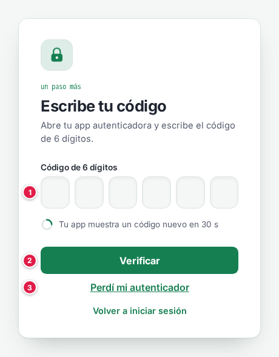

| # | Elemento | Qué hace |
|:-:|---|---|
| 1 | Código de 6 dígitos | El código que muestra tu app o que llegó a tu correo |
| 2 | Verificar | Confirma el código y abre la plataforma |
| 3 | Perdí mi autenticador | Si ya no tienes la app, te envía un código al correo de tu cuenta para configurar una app nueva |

**Perdí mi autenticador:** pulsa el enlace, escribe el código que llega a tu correo y escanea el
nuevo código QR con tu app. La app anterior deja de servir en ese momento.

### 5.4 Recuperar la contraseña

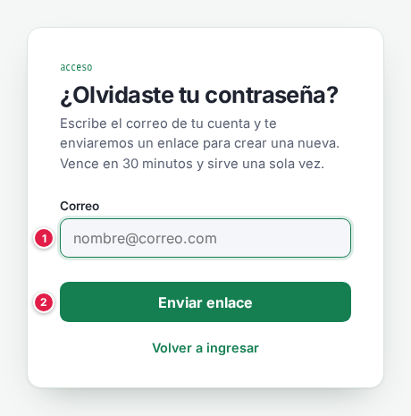

| # | Elemento | Qué hace |
|:-:|---|---|
| 1 | Correo | El correo de tu cuenta |
| 2 | Enviar enlace | Envía a ese correo un enlace para crear una contraseña nueva |

El mensaje es el mismo exista o no la cuenta. Abre el enlace del correo (vence en poco tiempo y
sirve una sola vez), escribe la contraseña nueva y vuelve a ingresar.

## 6. Pantalla principal

Al ingresar se abre **Proyectos**, con los proyectos de tu cuenta.

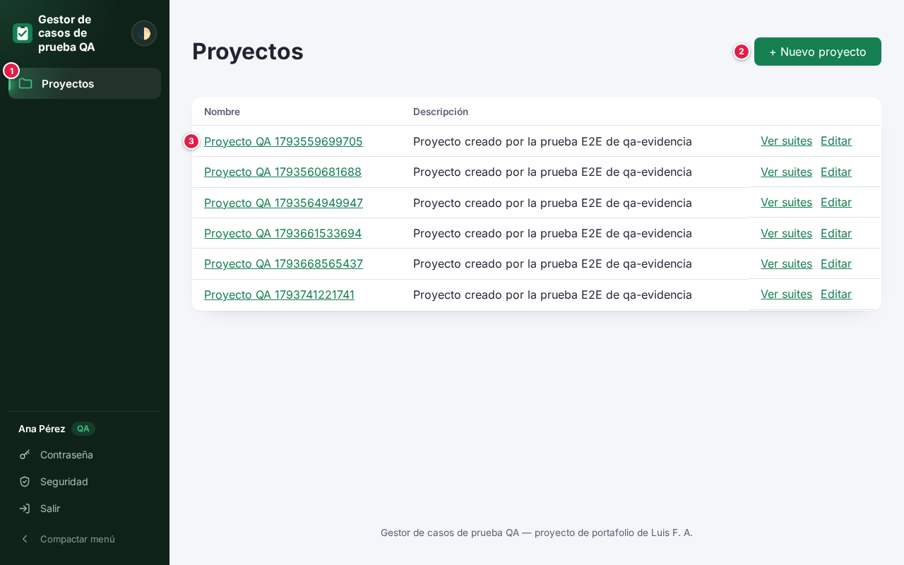

| # | Elemento | Qué hace |
|:-:|---|---|
| 1 | Menú lateral | Lleva a Proyectos y, dentro de un proyecto, a Suites, Dashboard y Defectos |
| 2 | + Nuevo proyecto | Abre el formulario para crear un proyecto (8.1) |
| 3 | Nombre del proyecto | Abre sus suites; **Ver suites** hace lo mismo y **Editar** cambia su nombre o descripción |

## 7. Navegación

En el computador el menú está a la izquierda. Al entrar a un proyecto aparecen sus opciones
(**Suites**, **Dashboard** y **Defectos**). **Compactar menú** lo reduce a íconos y, al pasar el
cursor, muestra el nombre de cada opción.

| Menú compacto (computador) | Celular con la hoja "Más" |
|:-:|:-:|
| 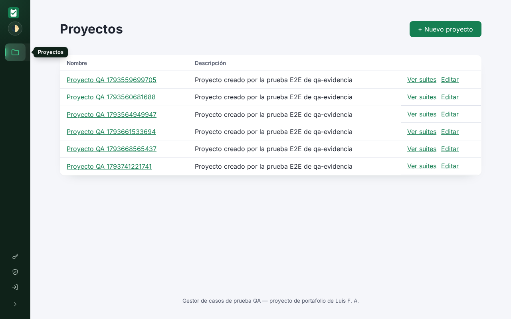 | 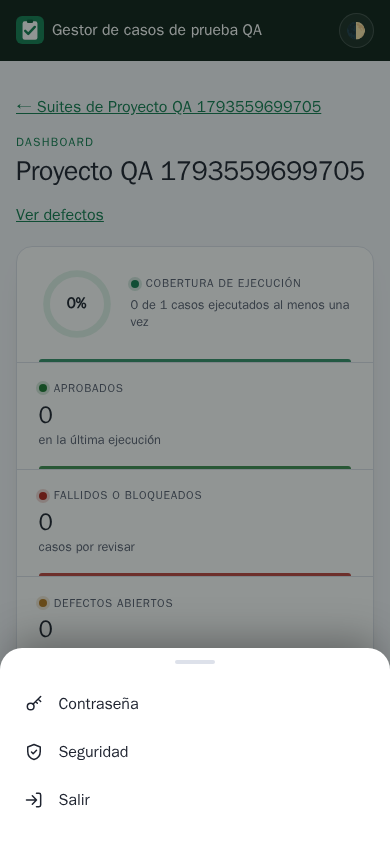 |

En el celular y la tablet en vertical, el menú pasa a una barra inferior; **Más** abre una hoja con
**Contraseña**, **Seguridad** y **Salir**. El botón ◐ cambia entre tema claro y oscuro.

## 8. Funcionalidades

### 8.1 Crear: proyectos, casos y ejecuciones

**Proyecto.** En Proyectos pulsa **+ Nuevo proyecto**.

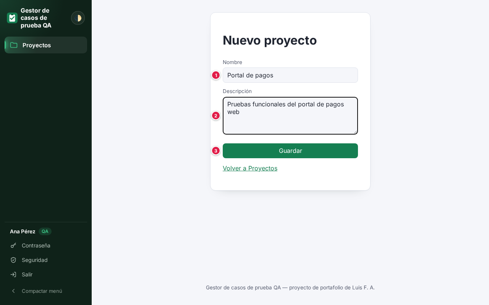

| # | Campo | Qué escribir |
|:-:|---|---|
| 1 | Nombre | El nombre del proyecto (obligatorio) |
| 2 | Descripción | De qué trata el proyecto |
| 3 | Guardar | Crea el proyecto |

Dentro del proyecto, **+ Nueva suite** crea una suite (un grupo de casos relacionados) con nombre
y descripción.

**Caso de prueba.** Dentro de una suite pulsa **+ Nuevo caso**.

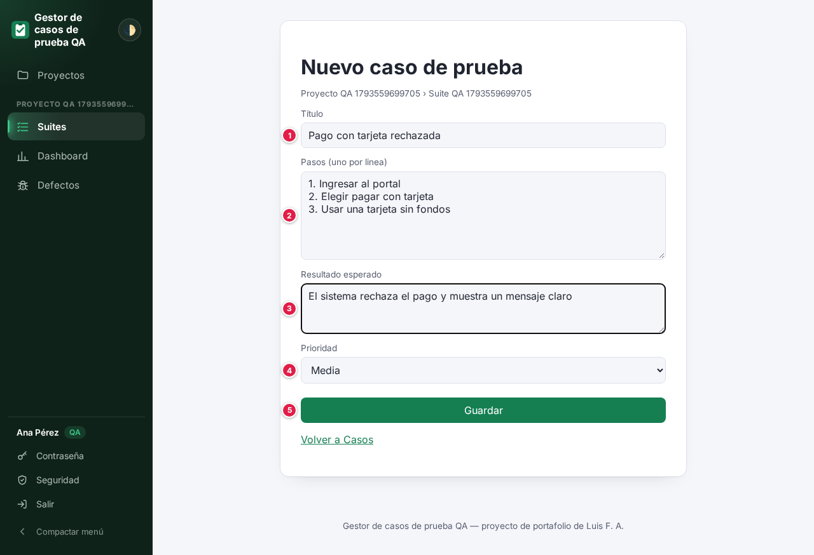

| # | Campo | Qué escribir |
|:-:|---|---|
| 1 | Título | Qué se prueba (obligatorio) |
| 2 | Pasos | Los pasos, uno por línea |
| 3 | Resultado esperado | Lo que debe pasar si todo funciona |
| 4 | Prioridad | Alta, Media o Baja |
| 5 | Guardar | Crea el caso (los campos visibles en tu pantalla se numeran en orden) |

**Ejecución.** En la lista de casos pulsa **Ejecutar**: se abre el caso con sus pasos y el
formulario para registrar el resultado.

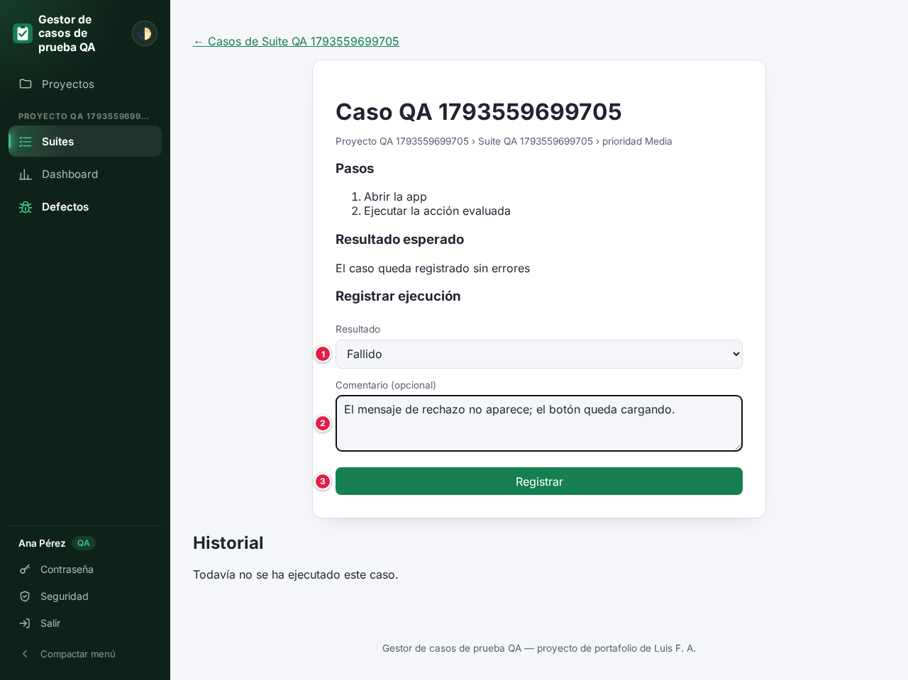

| # | Campo | Qué hacer |
|:-:|---|---|
| 1 | Resultado | **Aprobado**, **Fallido**, **Bloqueado** u **Omitido** |
| 2 | Comentario | Opcional: qué pasó, sobre todo si falló |
| 3 | Registrar | Guarda la ejecución en el historial del caso |

### 8.2 Consultar: suites y casos

**Suites.** Al abrir un proyecto ves sus suites.

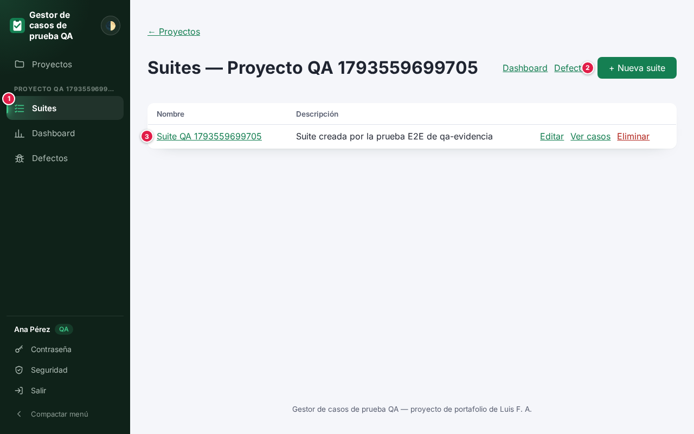

| # | Elemento | Qué hace |
|:-:|---|---|
| 1 | Suites | La sección del proyecto en la que estás |
| 2 | + Nueva suite | Crea una suite |
| 3 | Nombre de la suite | Abre sus casos |

**Casos.** Cada suite muestra sus casos con prioridad, estado y último resultado.

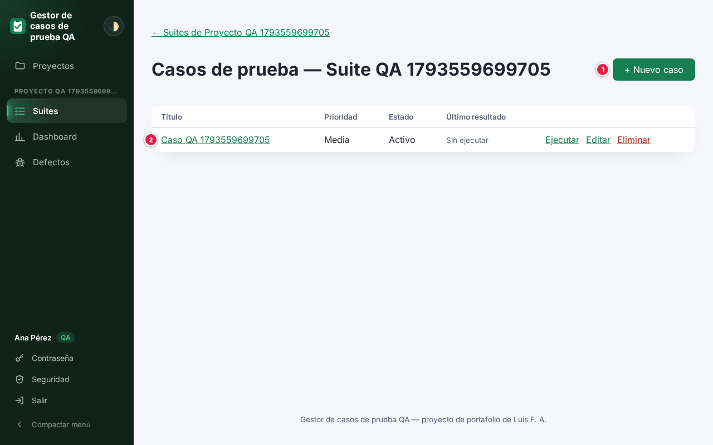

| # | Elemento | Qué hace |
|:-:|---|---|
| 1 | + Nuevo caso | Crea un caso en la suite |
| 2 | Título del caso | Abre su edición; **Ejecutar** registra un resultado y **Eliminar** lo borra |

### 8.3 Modificar: editar un caso

Pulsa el título del caso o **Editar**: se abre el formulario con los datos cargados.

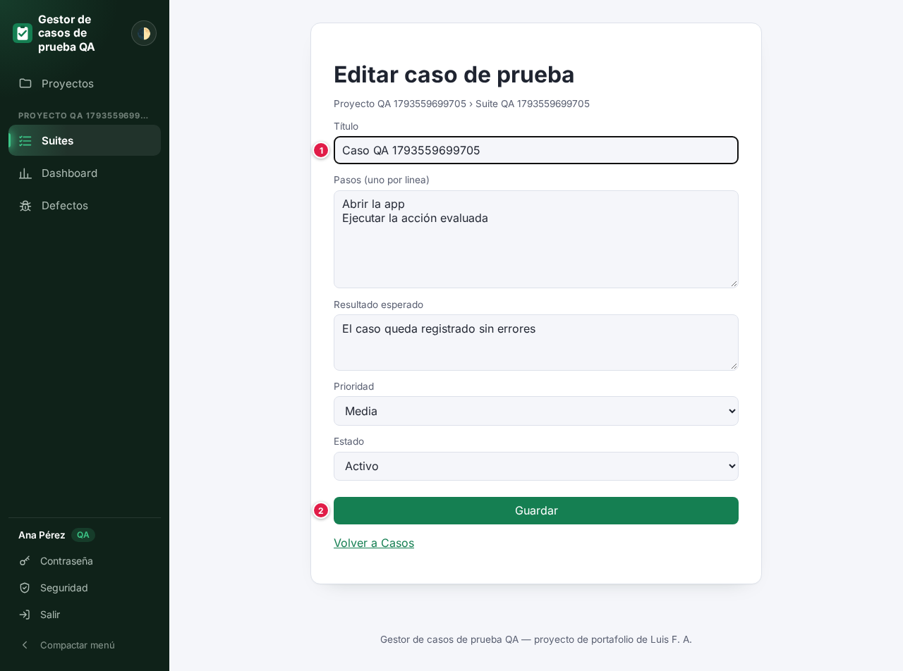

| # | Elemento | Qué hace |
|:-:|---|---|
| 1 | Campos del caso | Cambia el título, los pasos, el resultado esperado, la prioridad o el estado |
| 2 | Guardar | Guarda los cambios |

Los proyectos y las suites se editan igual, con **Editar** en su lista.

### 8.4 Reportar: dashboard y defectos

**Dashboard.** En el menú del proyecto, **Dashboard** muestra la cobertura y los resultados.

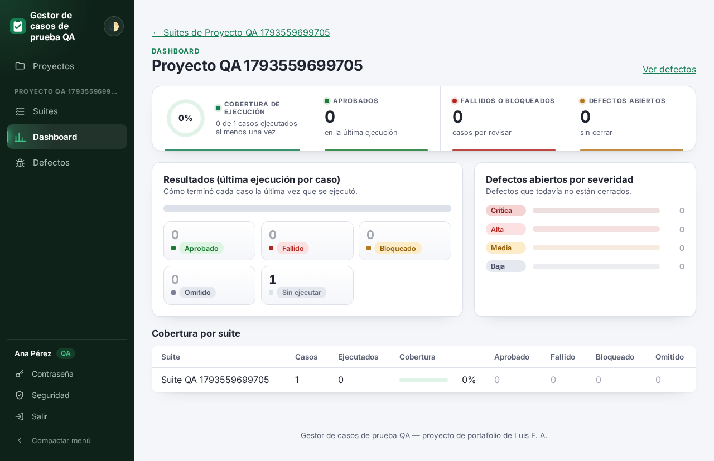

| Bloque | Qué muestra |
|---|---|
| Cobertura de ejecución | Cuántos casos se han ejecutado al menos una vez |
| Aprobados / Fallidos o bloqueados | Resultados de la última ejecución de cada caso |
| Defectos abiertos | Los que todavía no están cerrados, por severidad (Crítica, Alta, Media, Baja) |
| Cobertura por suite | Casos, ejecutados y resultados de cada suite |

**Defectos.** Cuando una ejecución queda **Fallida** o **Bloqueada**, en su historial aparece
**Reportar defecto**: el formulario pide título, descripción y severidad, y el defecto queda
vinculado a esa ejecución. **Defectos**, en el menú del proyecto, los lista con su severidad y
estado.

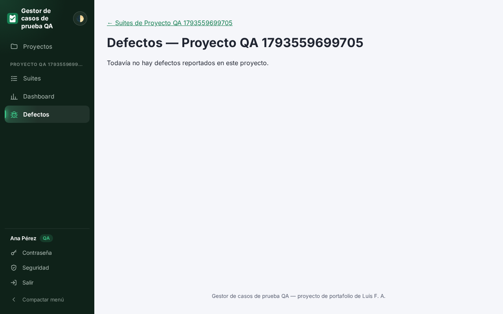

## 9. Gestión de perfil

### 9.1 Cambiar contraseña

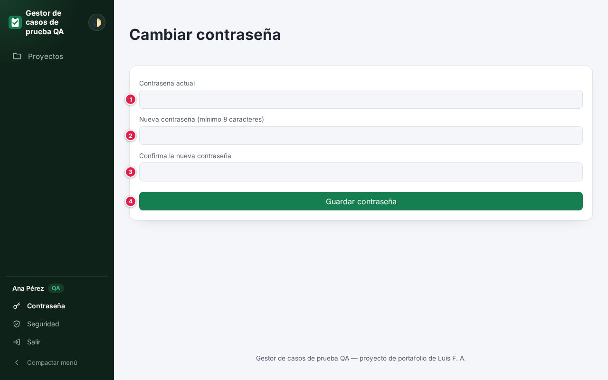

| # | Campo | Qué escribir |
|:-:|---|---|
| 1 | Contraseña actual | Tu contraseña de hoy |
| 2 | Nueva contraseña | Mínimo 8 caracteres |
| 3 | Confirma la nueva contraseña | La misma contraseña nueva |
| 4 | Guardar contraseña | Guarda el cambio; se cierran tus otras sesiones |

### 9.2 Seguridad

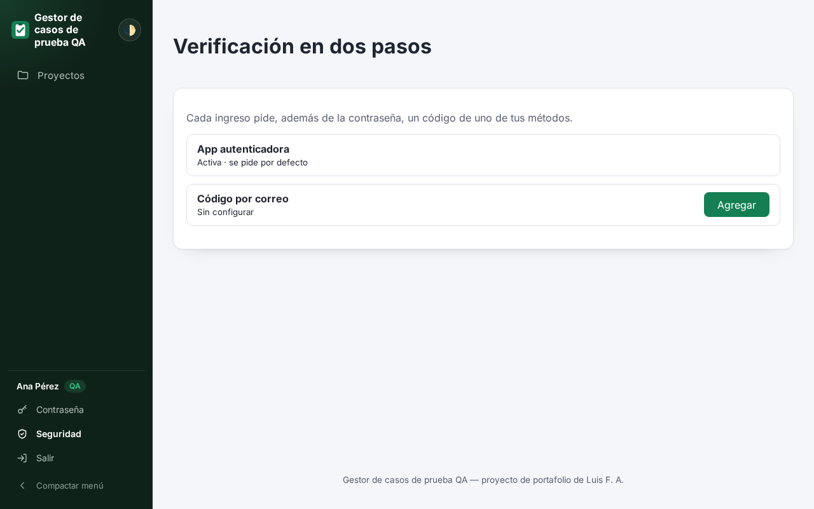

| Método | Qué puedes hacer |
|---|---|
| App autenticadora | Ver si está activa y si es el método que se pide por defecto |
| Código por correo | **Agregar** el método que te falta o **Pedir este por defecto** |

Tener los dos métodos activos te permite entrar aunque no tengas el celular a mano.

## 10. Mensajes frecuentes

| Mensaje | Qué significa | Qué hacer |
|---|---|---|
| Correo o contraseña incorrectos. | Los datos no coinciden | Revísalos o usa **¿Olvidaste tu contraseña?** |
| El código no es correcto o ya venció. | El código escrito no es el vigente | Escribe el código que muestra ahora la app |
| Pediste varios códigos seguidos. Espera unos minutos. | Se pidieron muchos códigos en poco tiempo | Espera unos minutos y vuelve a pedirlo |
| El nombre es obligatorio. / El título es obligatorio. | Falta el dato principal del formulario | Complétalo y guarda de nuevo |
| Tu contraseña quedó actualizada. Se cerraron tus otras sesiones. | El cambio quedó guardado | Usa la contraseña nueva en tus otros equipos |
| Esta cuenta está suspendida. | La cuenta no está habilitada | Escribe a soporte (ver 11) |
| Página no encontrada | La dirección que abriste no existe | Vuelve con el menú |
| Sin conexión | Tu equipo no tiene internet | La pantalla reintenta sola |

| Página no encontrada | Sin conexión |
|:-:|:-:|
| 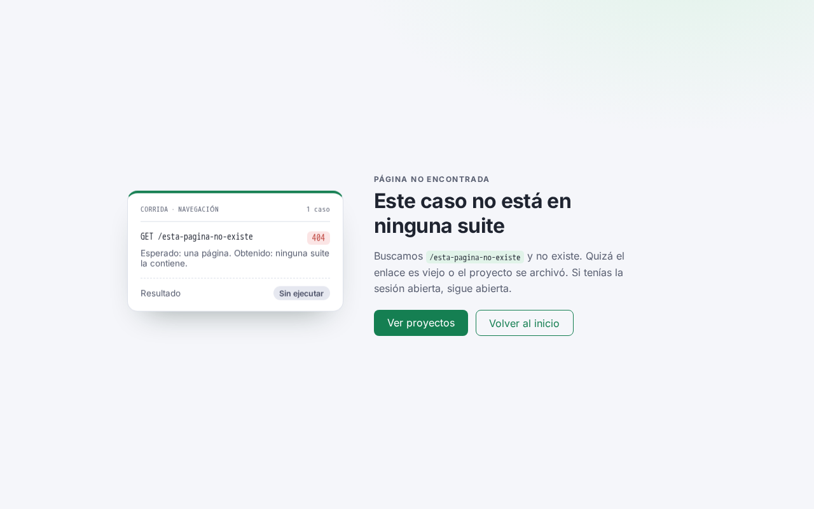 | 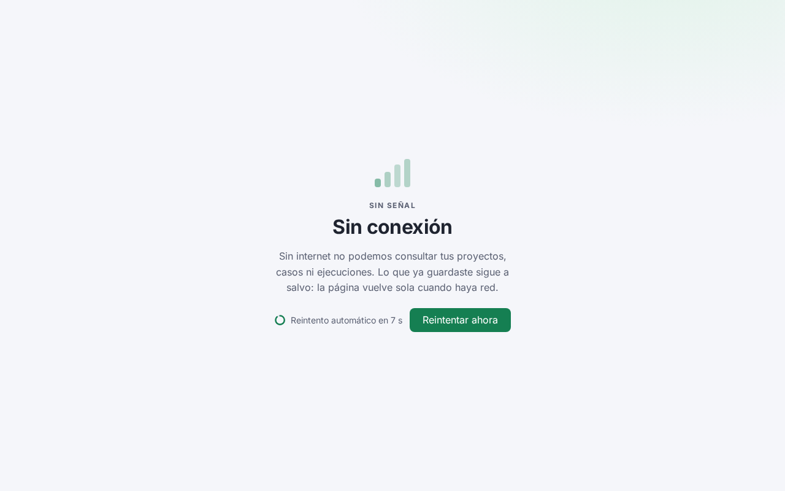 |

## 11. Preguntas frecuentes

**¿Por qué la primera carga tarda unos segundos?** El servicio se suspende cuando nadie lo usa; la
primera acción lo reactiva.

**¿Otra persona puede ver mis proyectos?** No. Cada cuenta ve sus propios proyectos.

**¿Puedo reportar un defecto sin ejecutar el caso?** No: el defecto nace de una ejecución fallida o
bloqueada, así queda claro dónde y cuándo apareció.

**¿Se puede instalar como aplicación?** Sí: en Chrome o Edge, **Instalar aplicación**; en iPhone,
Safari → **Compartir → Agregar a inicio**.

**¿Dónde pido ayuda o reporto un problema?** Telegram [@lfac6](https://t.me/lfac6), WhatsApp
[@carraian160](https://wa.me/carraian160) o [ariascluisf@hotmail.com](mailto:ariascluisf@hotmail.com).

## 12. Glosario

| Término | Qué significa |
|---|---|
| **App autenticadora** | Aplicación del celular que muestra un código nuevo cada 30 segundos para confirmar que eres tú |
| **Caso de prueba** | Una verificación concreta: pasos a seguir y resultado esperado |
| **Cobertura** | Porcentaje de casos que se han ejecutado al menos una vez |
| **Defecto** | Un problema encontrado al ejecutar un caso |
| **Ejecución** | Cada vez que se corre un caso y se registra su resultado |
| **Severidad** | Qué tan grave es un defecto: Crítica, Alta, Media o Baja |
| **Suite** | Un grupo de casos de prueba relacionados |
| **Verificación en dos pasos** | Además de la contraseña, se pide un código que solo tú puedes recibir |
