# 📘 Manual de usuario · Gestor de Casos de Prueba QA

Guía para usar la plataforma paso a paso: qué significa cada campo, qué datos se ingresan y qué
protege la plataforma. Para la parte técnica vuelve al [README](../README.md).

**Demo:** [Gestor QA (AWS Lambda)](https://immxew65sfxj7nubwzlszdimfi0qegzc.lambda-url.us-east-1.on.aws/)

## Contenido

1. [Proyecto: objetivos y alcances](#1-proyecto-objetivos-y-alcances)
2. [Glosario](#2-glosario)
3. [Plataformas, base de datos y servicios](#3-plataformas-base-de-datos-y-servicios)
4. [Paso a paso](#4-paso-a-paso)
5. [Seguridad: tu información protegida](#5-seguridad-tu-información-protegida)
6. [Agradecimientos](#6-agradecimientos)

---

## 1. Proyecto: objetivos y alcances

### Objetivo

Es el cuaderno de trabajo de un equipo de QA. El trabajo se organiza así:

```
Proyecto → Suites de prueba → Casos de prueba → Ejecuciones → Defectos
```

Defines qué vas a probar, anotas el resultado de cada ejecución, reportas los defectos y ves la
cobertura en un tablero.

### Alcance: qué necesitas y qué esperar

- Solo necesitas un navegador.
- Al crear tu cuenta, la plataforma te agrega **proyectos de ejemplo** con suites y casos ya
  escritos, para que veas cómo se usa desde el primer momento.

### Límites

Es una demo de portafolio:

- No hay bloqueo por intentos fallidos ni recuperación de contraseña por correo.
- La contraseña solo exige 8 caracteres: usa una frase larga que no uses en otros sitios.
- No escribas datos personales o confidenciales en los casos y defectos.

## 2. Glosario

Palabras técnicas que aparecen en este manual, explicadas en lenguaje simple.

| Término | Qué significa |
|---|---|
| **Administrador** | Cuenta con permisos para gestionar usuarios y configuraciones de la aplicación. |
| **API** | Puerta de entrada de un programa para que otros programas le pidan o le envíen datos. |
| **Backend** | La parte de la aplicación que trabaja "detrás": procesa lo que envías y habla con la base de datos. |
| **Base de datos** | Lugar donde la aplicación guarda la información de forma ordenada y permanente. |
| **Caso de prueba** | Pasos y resultado esperado para comprobar que una función de un sistema trabaja bien. |
| **Contraseña cifrada (hash)** | La contraseña no se guarda tal cual, sino como una "huella" de la que no se puede recuperar el texto original. |
| **Cookie** | Pequeño dato que el navegador guarda para recordar tu sesión en ese sitio. |
| **Defecto (bug)** | Error encontrado al probar: el sistema no hace lo que debería. |
| **JWT** | Tipo de token firmado digitalmente: si alguien lo altera, el servidor lo rechaza. |
| **Modo mantenimiento** | Pantalla que aparece cuando el servicio o su base de datos no responden; se recupera sola cuando vuelven. |
| **Navegador** | Programa con el que abres páginas web: Chrome, Edge, Firefox, Safari. |
| **Nube** | Servidores de una empresa (Amazon, Microsoft, Google, Oracle…) donde la aplicación funciona sin depender de un computador propio. |
| **Rate limit (límite de intentos)** | Tope de intentos en poco tiempo, para frenar a quien intenta adivinar contraseñas. |
| **Rol** | Tipo de cuenta que define qué puede hacer cada persona (por ejemplo, usuario o administrador). |
| **Servidor** | Computador en la nube que atiende las peticiones de la aplicación. |
| **Sesión** | El tiempo en que la aplicación te reconoce después de iniciar sesión, sin pedirte la contraseña de nuevo. |
| **Suite de pruebas** | Grupo de casos de prueba relacionados. |
| **Variables de entorno / secretos** | Claves y contraseñas internas de la aplicación, guardadas fuera del código para que no queden expuestas. |

## 3. Plataformas, base de datos y servicios

Qué servicio de nube, base de datos o API usa el proyecto y para qué sirve cada uno.

| Plataforma | Tipo | Qué hace en el proyecto |
|---|---|---|
|  | Nube | Ejecuta la app FastAPI mediante el adaptador Mangum, expuesta con una Function URL (sin API Gateway). |
|  | Base de datos | MongoDB Atlas guarda las seis colecciones: `usuarios`, `proyectos`, `suites`, `casos_prueba`, `ejecuciones` y `defectos`. No requiere ningún otro servicio ni clave de API. |
|  | Pruebas automatizadas | Prueba la demo automáticamente dos veces al día y publica la evidencia. |

## 4. Paso a paso

### 4.1 Crear una cuenta

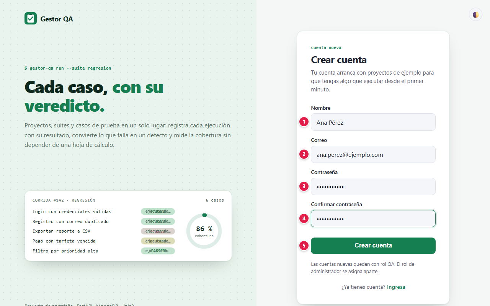

| # | Campo | Qué escribir | Reglas |
|:-:|---|---|---|
| 1 | Nombre | Tu nombre; aparece arriba a la derecha | Obligatorio |
| 2 | Correo | El correo con el que vas a entrar | Formato válido y único |
| 3 | Contraseña | Tu contraseña | Mínimo **8 caracteres** |
| 4 | Confirmar contraseña | La misma contraseña | Debe coincidir con el campo 3 |
| 5 | Crear cuenta | Botón | Crea la cuenta con rol **QA** y te deja con la sesión iniciada |

El registro siempre crea cuentas con rol QA. El rol de administrador no se puede pedir desde el
formulario.

### 4.2 Iniciar sesión

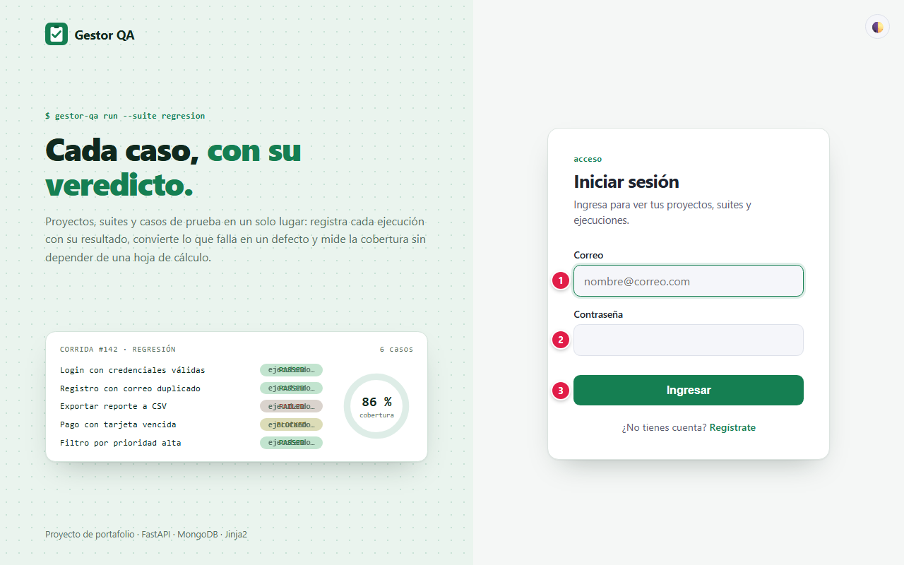

| # | Campo | Qué escribir |
|:-:|---|---|
| 1 | Correo | El correo de tu cuenta |
| 2 | Contraseña | Tu contraseña |
| 3 | Ingresar | Abre tu lista de proyectos |

Si el correo o la contraseña no coinciden, el mensaje es el mismo en ambos casos.

### 4.3 Proyectos

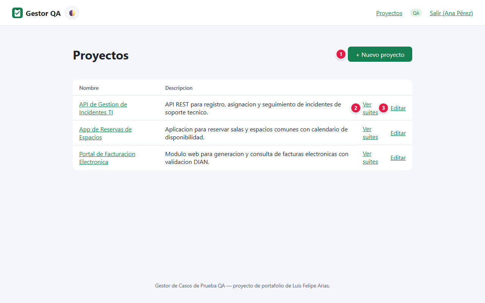

| # | Elemento | Qué hace |
|:-:|---|---|
| 1 | + Nuevo proyecto | Abre el formulario para crear un proyecto |
| 2 | Ver suites | Entra al proyecto |
| 3 | Editar | Cambia el nombre o la descripción |

Solo ves **tus** proyectos. El administrador ve todos.

### 4.4 Crear un proyecto

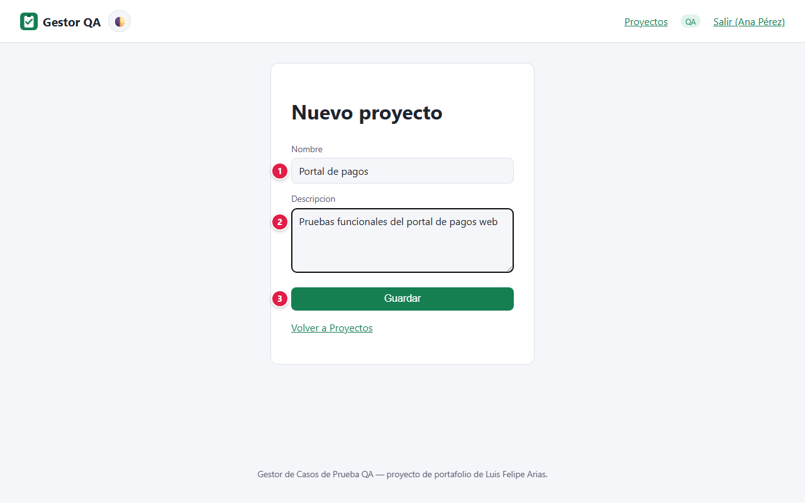

| # | Campo | Qué escribir | Reglas |
|:-:|---|---|---|
| 1 | Nombre | Nombre del sistema o producto que vas a probar | Obligatorio |
| 2 | Descripción | Alcance de las pruebas | Opcional |
| 3 | Guardar | Botón | Crea el proyecto |

### 4.5 Suites de prueba

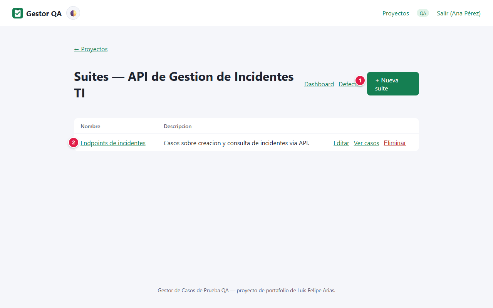

Una suite agrupa casos de un mismo módulo o tipo de prueba.

| # | Elemento | Qué hace |
|:-:|---|---|
| 1 | + Nueva suite | Crea una suite con **Nombre** (obligatorio) y **Descripción** |
| 2 | Ver casos | Entra a los casos de la suite |

Cada suite también ofrece **Editar** y **Eliminar**.

### 4.6 Casos de prueba

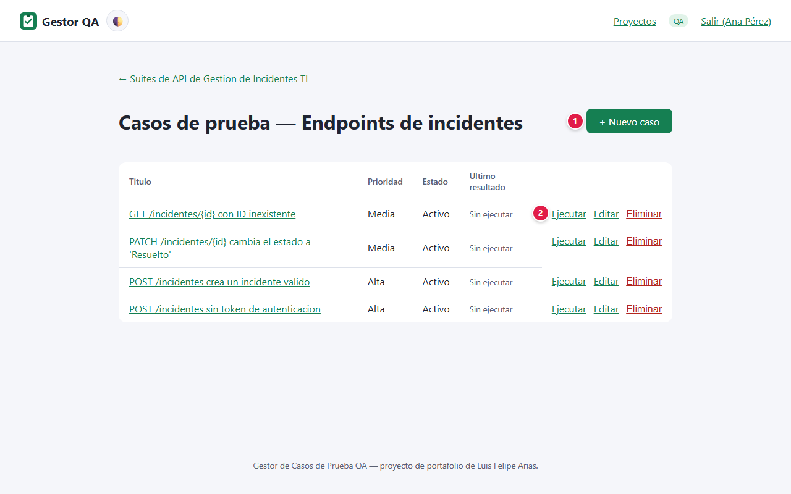

| # | Elemento | Qué hace |
|:-:|---|---|
| 1 | + Nuevo caso | Abre el formulario del caso |
| 2 | Ejecutar | Registra el resultado de una ejecución |

La columna **Último resultado** muestra cómo terminó la ejecución más reciente.

### 4.7 Crear un caso

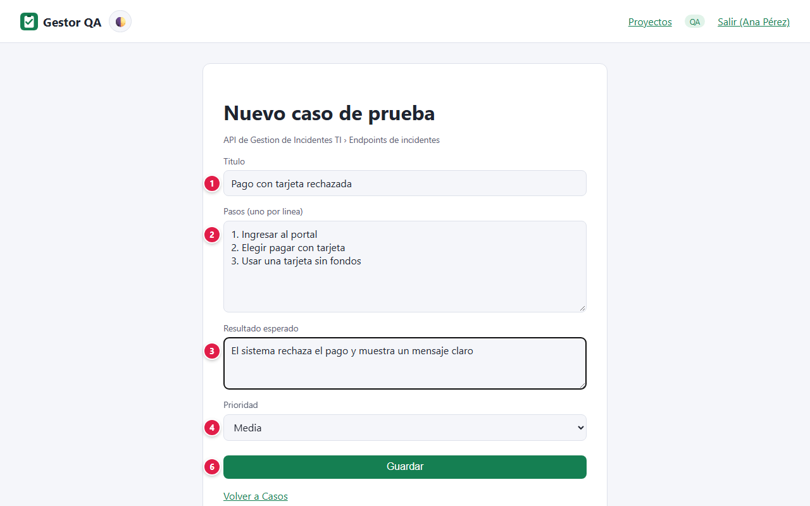

| # | Campo | Qué escribir | Reglas |
|:-:|---|---|---|
| 1 | Título | Qué valida el caso, en una frase | Obligatorio |
| 2 | Pasos | Las acciones a seguir, **una por línea** | Cada línea se guarda como un paso numerado |
| 3 | Resultado esperado | Qué debe ocurrir si el sistema funciona bien | — |
| 4 | Prioridad | Alta, Media o Baja | Por defecto, Media |
| 5 | Estado | Activo u Obsoleto | Los obsoletos se conservan como historial |
| 6 | Guardar | Botón | Crea el caso |

### 4.8 Ejecutar un caso

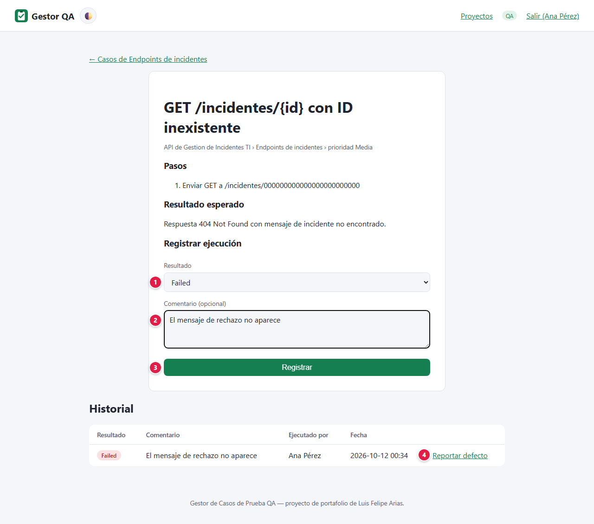

| # | Campo | Qué escribir |
|:-:|---|---|
| 1 | Resultado | **Passed** (pasó), **Failed** (falló), **Blocked** (no se pudo ejecutar) o **Skipped** (se omitió) |
| 2 | Comentario | Opcional: qué observaste |
| 3 | Registrar | Guarda la ejecución en el **Historial** |
| 4 | Reportar defecto | Aparece en las ejecuciones fallidas para registrar el defecto encontrado |

### 4.9 Reportar un defecto

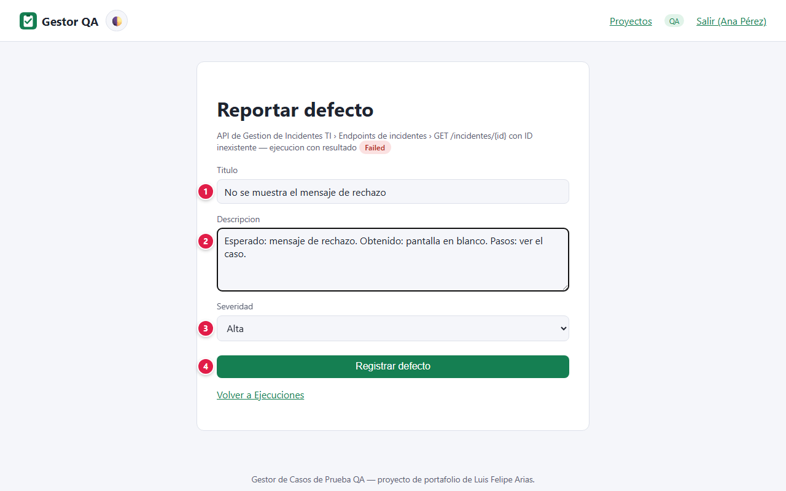

| # | Campo | Qué escribir |
|:-:|---|---|
| 1 | Título | Resumen del problema |
| 2 | Descripción | Qué se esperaba, qué pasó y cómo reproducirlo |
| 3 | Severidad | Crítica, Alta, Media o Baja |
| 4 | Registrar defecto | Botón |

### 4.10 Seguimiento de defectos

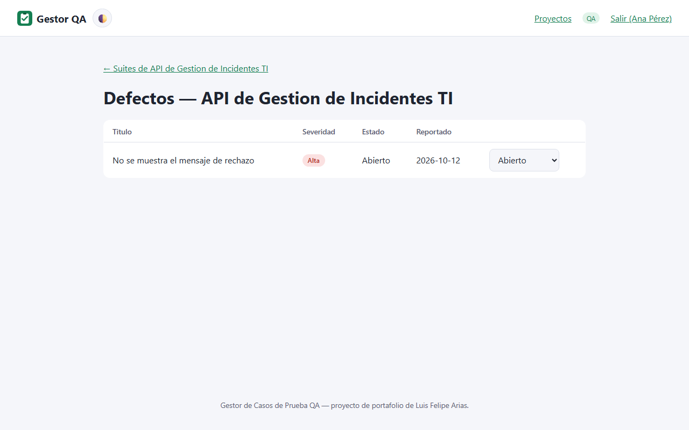

En **Defectos** cambias el estado de cada uno: **Abierto**, **En progreso** o **Cerrado**.

### 4.11 Dashboard de cobertura

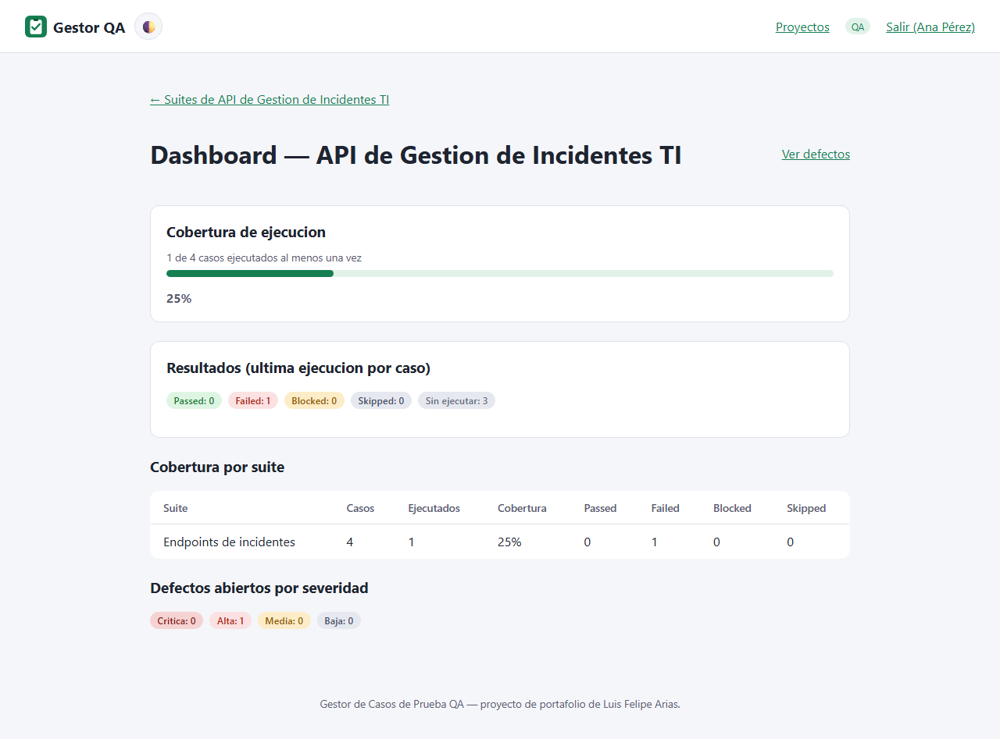

| Bloque | Qué muestra |
|---|---|
| Cobertura de ejecución | Porcentaje de casos ejecutados al menos una vez |
| Resultados | Cuántos casos terminaron en Passed, Failed, Blocked o Skipped en su última ejecución, y cuántos siguen sin ejecutar |
| Cobertura por suite | El mismo detalle, suite por suite |
| Defectos abiertos por severidad | Cuántos defectos siguen abiertos de cada severidad |

### 4.12 Preguntas frecuentes

**¿De dónde salieron los proyectos que veo al entrar?** Son los proyectos de ejemplo que la
plataforma crea al registrarte. Puedes editarlos o usarlos como plantilla.

**¿Puedo borrar un proyecto?** Archivar y eliminar proyectos es una acción reservada al
administrador, para no perder historial de pruebas por error.

**¿Qué diferencia hay entre Blocked y Skipped?** *Blocked*: el caso no se pudo ejecutar por un
impedimento (ambiente caído, dato faltante). *Skipped*: se decidió no ejecutarlo en esa ronda.

**¿Qué significa la pantalla "Estamos en mantenimiento"?** El servicio o su base de datos no están respondiendo en ese momento. No se perdió nada: tus proyectos, suites, casos y defectos siguen guardados, y ninguna acción quedó a medias (si no viste la confirmación, no se guardó). La pantalla se actualiza sola y vuelve a la normalidad apenas el servicio responda; también puedes reintentar más tarde.

## 5. Seguridad: tu información protegida

Tu confianza es lo primero: la plataforma solo pide los datos necesarios para funcionar, los protege y no los comparte con terceros. Esto es lo que se guarda y cómo se protege.

### Qué datos se guardan y dónde

| Dato | Para qué se usa | Dónde se guarda | Quién lo ve |
|---|---|---|---|
| Nombre y correo | Identificar tu cuenta | MongoDB Atlas | Tú y el administrador |
| Contraseña | Iniciar sesión | MongoDB Atlas, **solo su huella bcrypt** | Nadie: no se puede leer ni recuperar |
| Proyectos, suites, casos, ejecuciones y defectos | Tu trabajo de QA | MongoDB Atlas, marcados con tu cuenta | Tú y el administrador |
| Sesión | Mantenerte conectado | Cookie en tu navegador | Firmada, invisible para JavaScript, vence a las 8 horas |

### Cómo se protege tu información

Comprobado en el código del proyecto (`backend/app/seguridad.py`, `dependencias.py`,
`routers/web_auth.py`):

- **Contraseñas con bcrypt** (12 rondas). Solo se guarda la huella.
- **Sesión con JWT en cookie `HttpOnly` y `SameSite=Lax`**, firmada con una clave secreta del
  servidor y válida por 8 horas. **Salir** la borra.
- **Control de acceso por dueño:** cada proyecto, con todo lo que contiene, solo lo puede ver o
  editar quien lo creó o un administrador. Cambiar el identificador en la URL no da acceso a
  proyectos ajenos.
- **Roles separados:** el registro solo crea cuentas QA; el administrador se crea aparte, por
  comando, nunca desde un formulario. Solo el administrador puede archivar o eliminar proyectos y
  suspender cuentas.
- **Suspensión inmediata:** en cada petición se revisa que la cuenta siga activa; una cuenta
  suspendida queda fuera sin esperar a que venza su sesión.
- **Mensaje de error genérico** al iniciar sesión, para no revelar qué correos existen.
- **Plantillas con escape automático** (Jinja2): lo que escribes se muestra como texto, no como
  código.
- **Secretos fuera del repositorio:** la conexión a MongoDB y la clave JWT viven en variables de
  entorno de AWS Lambda.

## 6. Agradecimientos

A mi familia, por su apoyo incondicional, su paciencia y por creer en cada proyecto incluso cuando apenas era una idea. Este trabajo también es de ustedes.

Y a ti, que usas esta plataforma: cada prueba, comentario y sugerencia ayuda a que siga mejorando.
